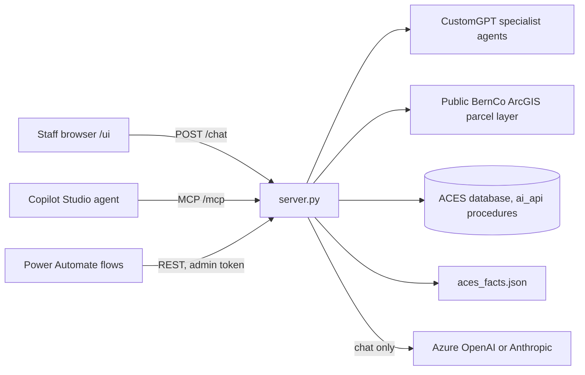

# A.C.E.S. MCP server

Internal tool server for Bernalillo County Assessor's Office staff. It gives staff one
place to ask questions and get answers from the office's specialist chatbots, the ACES
database, public parcel data and a reviewed facts file.

It serves the same tools two ways:

- **MCP** at `/mcp`, for the Copilot Studio staff agent and CustomGPT.
- **A staff chat page** at `/ui`. The server runs the conversation with a chat model,
  which picks the tools to call.

Everything is read-only. No tool writes to iasWorld, the ACES database or any county
system.

## How it fits together



| File | What it does |
|---|---|
| `server.py` | The app: the MCP tool definitions, the chat page, `/health`, and wiring the modules below together. |
| `aces_access.py` | Who may call what: the access key for `/mcp` and `/chat`, county sign-in, and the admin token. |
| `aces_customgpt.py` | The CustomGPT specialists: settings, the task cache, submitting and polling tasks, and download links for generated files. |
| `aces_routing.py` | Reads a staff prompt to decide what extra work it needs (HomeHarvest, a report, a map, an ArcGIS-only lookup). |
| `aces_arcgis.py` | The public BernCo ArcGIS parcel layer: lookups, map links, candidate peers and parcel context for specialist prompts. |
| `aces_rest.py` | REST wrappers for Power Automate and the admin debug routes. |
| `aces_common.py` | Small shared helpers: logging, time, hashing, text and JSON. |
| `aces_sql_tools.py` | The 10 read-only ACES data tools. Each calls fixed stored procedures in the `ai_api` schema with bound parameters. |
| `aces_chat.py` | `POST /chat`: the tool loop behind the staff chat page, for either Azure OpenAI or Anthropic. |
| `aces_charts.py` | `Build_Chart`, a chat-only tool. It reads every chart value from a data tool result already in the conversation, never from the model. |
| `aces_facts.py`, `aces_facts.json` | `ACES_Key_Facts`: staff-reviewed figures, deadlines and citations. |
| `sign_facts.py` | Signs reviewed facts rows with a reviewer's name and today's date. |
| `web_ui.html` | The staff chat page. |
| `start-aces.bat`, `start-aces.ps1` | Starts the server on a Windows PC and opens the chat. |
| `deploy.ps1` | Builds and deploys the container to Azure App Service, with checks and automatic rollback. |
| `Dockerfile` | Container image: Python 3.12 plus Microsoft ODBC Driver 18. |
| `sql/` | The `ai_api` schema snapshot, the export script, the numbered changes in the order they were applied, and the limited login. See `sql/README.md`. |
| `tests/` | Tests that run without any network or database. |
| `examples/` | Sample MCP requests. |

## Tools

| Tool | Source | Notes |
|---|---|---|
| `Community_Educator` | CustomGPT 9262 | Public-facing process, exemptions, notices, protests, forms. |
| `Assessment_Context_Expert` | CustomGPT 94006 | Record interpretation and assessment context. Slow; may return a task ID. |
| `Clear_Expectations` | CustomGPT 49501 | Staff, HR, training and internal policy. |
| `Compliance_Expert` | CustomGPT 37400 | Legal and statutory questions. |
| `Smart_Tasks` | CustomGPT 9262 (Plan & Act) | Multi-step work: files, analysis, exports. |
| `Check_CustomGPT_Task` | CustomGPT | Picks up a specialist answer that wasn't ready yet. |
| `ArcGIS_Public_Parcel_Lookup` | Public BernCo ArcGIS | Parcel lookup by address, UPC or owner. |
| `ArcGIS_Public_Parcel_Map` | Public BernCo ArcGIS | Assessor map and Google Maps links. |
| `ArcGIS_Public_Candidate_Peers` | Public BernCo ArcGIS | Possible comparable parcels from public GIS fields only. |
| `UPC_Router_Link` | No outside call | Link that opens the field route planner with the UPCs filled in. |
| `ACES_Key_Facts` | `aces_facts.json` | Reviewed facts. See below. |
| `ACES_Office_Volume` | ACES database | Calls and walk-in visits by day, week or month. |
| `ACES_Forecast` | ACES database | Daily call and visit forecast with 80% and 95% ranges. |
| `ACES_Forecast_Accuracy` | ACES database | How past forecasts did. |
| `ACES_Season_Outlook` | ACES database | Day-by-day outlook for known busy seasons. |
| `ACES_Assessment_Calendar` | ACES database | Assessment-calendar dates and their effect on volume. |
| `ACES_Daily_Briefing` | ACES database | Forecast, last open day, deeds and calendar in one call. |
| `ACES_Deed_Volume` | ACES database | Recorded deed volume. |
| `ACES_NOV_Parcel` | ACES database | Notice of Value details for one UPC. |
| `ACES_NOV_Search` | ACES database | Finds UPCs by street address. |
| `ACES_NOV_Coverage` | ACES database | Share of 3%+ increases with an explained reason. |

The SQL tools register only when `ACES_SQL_TOOLS_ENABLED=true` and the connection
settings are present. Without them the server lists 11 tools.

## Access control

| Route | Who can call it |
|---|---|
| `/mcp`, `/chat` | Callers with the MCP access key (`x-aces-mcp-key` header or `Authorization: Bearer`), or a county user signed in through App Service authentication (only the accounts in `ACES_ALLOWED_USERS`, when it's set). With no key configured, key callers get 503. |
| `/start-lookup`, `/check-pending-task`, `/smart-task`, `/agent-call`, `/data-tool`, `/arcgis-*` | Power Automate, with the admin token in the `x-aces-admin-token` header. |
| `/task-cache`, `/task-cache/clear`, `/check-task`, `/health/details` | Admin token only. Off when no admin token is set. `/health/details` shows the settings in effect and the tools actually registered. |
| `/context-expert-file/{token}` | Anyone with the link. Tokens are random and expire (`ACES_FILE_LINK_TTL_SECONDS`, default one day). |
| `/`, `/health`, `/ui` | Open. They return no data: `/health` says only that the server is up, its build and whether chat is on. `/ui` itself sends signed-out users to the county sign-in when sign-in is on. |

Points a reviewer usually asks about:

- **Key comparisons** use `secrets.compare_digest`. Tokens are read from headers only,
  never the query string, so they don't land in access logs.
- **Sign-in headers are trusted only when App Service authentication is really on**:
  `ACES_ENTRA_SIGNIN=true` *and* `WEBSITE_AUTH_ENABLED=true`. App Service sets the
  second one itself and strips client-sent `X-MS-CLIENT-PRINCIPAL*` headers. If
  authentication is turned off, the server falls back to the access key, so the headers
  can't be faked.
- **The chat page** is served with a per-request CSP nonce, `default-src 'none'`,
  `frame-ancestors 'none'` and `no-store`. The local launcher passes the access key in
  the URL fragment, which never reaches the server. The page keeps it in that tab's
  sessionStorage and clears it from the address bar.
- **CustomGPT IDs**: a caller-supplied project ID must be one of this server's own
  specialist projects, and task IDs may hold only letters, digits, dashes and
  underscores. Both go into CustomGPT URLs that carry the server's API token, so this
  stops a value like `9262/../../12345` from reaching another project or API path.
- **SQL**: procedure names are constants and every input is a bound parameter. There's
  no free-form SQL. The server's login can only EXECUTE the `ai_api` schema: on Azure
  that's the App Service managed identity, and on a county SQL Server it's
  `ACES_MCP_Reader` from `sql/55` and `sql/56`, which also check it. Each procedure logs
  its own calls to `ai_api.tool_log`.
- **Secrets** live only in app settings or, for local runs, in a DPAPI-encrypted file
  under `%LOCALAPPDATA%\ACES`. Nothing secret is in the repo or its history.

## What data goes where

- **Chat**: staff questions and the tool results needed to answer them go to the
  configured model. With Azure OpenAI that's the county's own Azure tenant, sent with
  `store=false`. With Anthropic it's the Anthropic API. Prompts and answers aren't
  written to the server log. The log gets tool names, timings, token counts, the length
  and a hash of each specialist question and, with sign-in on, the user's sign-in name.
- **Specialist tools**: the question goes to CustomGPT for that agent's project.
- **ArcGIS tools**: queries go to the county's public parcel layer.
- **Task cache** (`TASK_CACHE_FILE`): task IDs, hashes of prompts (not the text) and
  the specialists' answers, so a repeated question doesn't start a second CustomGPT task.
  An answer is reused for `ACES_ANSWER_CACHE_HOURS` (default 24) and then asked fresh,
  so a specialist's knowledge base update shows up within a day. Entries are dropped
  after `ACES_TASK_CACHE_KEEP_DAYS` (default 7). To see a knowledge base change right
  away, clear the cache (`POST /task-cache/clear` with the admin token). For evaluation
  runs, set `ACES_ANSWER_CACHE_HOURS=0` so no test is scored on a cached answer.

## Running it

### On a Windows PC

Double-click `start-aces.bat`. The first run asks for the secrets and saves them
encrypted for your Windows account. It then starts the server on `127.0.0.1:10000` and
opens the chat. Run `start-aces.bat` from a command prompt with `azure`, `shortcut` or
`reset` for the other options; the comments at the top of `start-aces.ps1` explain
each one.

Needs Python 3.11 or later, plus Microsoft ODBC Driver 18 for SQL Server for the data
tools.

### In a container

```
docker build -t aces-mcp .
docker run -p 8000:8000 -e ACES_MCP_API_KEY=... aces-mcp
```

`.dockerignore` is an allowlist: the image gets `server.py`, the `aces_*.py` modules,
`aces_facts.json`, `web_ui.html` and `requirements.txt`, and nothing else from the
folder, so a stray `.env` or token file can't be built in. `tests/test_container.py`
checks this. The server runs as an unprivileged `aces` user and writes only its two
cache files.

### Deploying to Azure App Service

`.\deploy.ps1` from the repo folder. It refuses to deploy uncommitted or unpushed code,
then compiles, runs the tests, starts the server locally and checks that every tool
lists. Only after that does it build in ACR and switch the app to the new image. If
`/health` and `/mcp` don't come up on the new build, it rolls back. After a deploy,
refresh the MCP tool in Copilot Studio so it picks up any description changes.

## Settings

All settings are environment variables. Only the first group is needed to start.

| Setting | Purpose |
|---|---|
| `ACES_MCP_API_KEY` | Access key for `/mcp` and `/chat`. |
| `ACES_ADMIN_TOKEN` | Turns on the REST wrappers and admin routes. |
| `HOST`, `PORT` | Defaults `0.0.0.0` and `10000`. Local runs use `127.0.0.1`. |
| `ACES_ENTRA_SIGNIN`, `ACES_ALLOWED_USERS` | County sign-in on Azure, and the comma-separated list of accounts allowed in. |
| `CUSTOMGPT_API_TOKEN` | CustomGPT API token. |
| `COMMUNITY_PROJECT_ID`, `ASSESSMENT_PROJECT_ID`, `CLEAR_PROJECT_ID`, `COMPLIANCE_PROJECT_ID`, `SMART_TASKS_PROJECT_ID` | CustomGPT project for each specialist. |
| `ACES_SQL_TOOLS_ENABLED`, `ACES_SQL_SERVER`, `ACES_SQL_DATABASE`, `ACES_SQL_AUTH`, `ACES_SQL_USER`, `ACES_SQL_PASSWORD`, `ACES_SQL_TRUST_SERVER_CERT` | ACES database connection. The options are explained at the top of `aces_sql_tools.py`. |
| `ACES_CHAT_PROVIDER`, `AZURE_OPENAI_ENDPOINT`, `AZURE_OPENAI_DEPLOYMENT`, `ANTHROPIC_API_KEY`, `ACES_ANTHROPIC_WORKSPACE_ID` | Chat model. The options are explained at the top of `aces_chat.py`. |
| `ACES_PUBLIC_BASE_URL` | This server's public address, for CustomGPT file download links. On App Service it defaults to the app's host name; with neither, file links are skipped. |
| `TASK_CACHE_FILE` | Default: `aces_task_cache.json` in the system temp folder (`/tmp` in the container, `%TEMP%` on Windows). On App Service, point it at `/home/...` so it survives restarts. |
| `ACES_ANSWER_CACHE_HOURS` | Default 24. How long a finished specialist answer is reused for the same question. `0` turns reuse off; use that for evaluation runs so every question reaches the specialist. |
| `ACES_TASK_CACHE_KEEP_DAYS` | Default 7. Cache entries untouched this long are dropped when the cache is saved. |
| `UPC_ROUTER_URL` | Address of the field route planner. |

Less common settings (poll intervals, task time limits, ArcGIS search sizes, HomeHarvest
behavior) are listed with their defaults near the top of `aces_customgpt.py` and
`aces_arcgis.py`.

## Reviewed facts

`aces_facts.json` holds figures that someone has signed off on. A row counts as
`reviewed` only when it also has `reviewed_by` and `last_reviewed`. Rows marked `draft`
are listed but never used as a check, and `open` rows make the chat say the question
isn't settled. A reviewed row older than `ACES_FACTS_REVIEW_DAYS` (default 365) is
flagged as overdue. Every change to the file goes through a commit, and
`tests/test_facts.py` checks the file's shape.

To sign rows after checking them against their sources:

```
python sign_facts.py "Your Name" row_id [row_id ...]
python sign_facts.py --list
```

`--list` shows each row's status and who signed it when.

## Tests and lint

```
python -m pip install -r requirements-dev.txt
python -m pytest
python -m ruff check .
python -m ruff format --check .
```

The tests run the real app in-process with dummy settings and a scripted chat model, so
they reach no network or database. They cover the tool list, access control on every
route group, the chat page headers, input checks on the SQL tools, the facts rules, the
chart builder and the chat tool loop. They don't make live calls to CustomGPT, ArcGIS
or SQL. After a deploy, `deploy.ps1` checks that the new build is healthy and lists
every tool; live answers are checked by hand.

## Database changes

`sql/` holds the database side. `sql/current/ai_api.sql` is the `ai_api` schema as it
is in the database (every procedure the tools call, the `tool_log` columns and every
permission on the schema), written by `sql/export_ai_api.py`; read it to check what the
server's login can run. The numbered scripts are the changes applied, in order, and 55
and 56 set up the limited login. `sql/README.md` explains each file.

## Known gaps

- **Live paths aren't covered by tests.** Access control is at 92% and `server.py` at
  75%, but the CustomGPT task path (26%), ArcGIS (16%) and the SQL tools (25%) need live
  services, so they're checked by hand after a deploy. Overall coverage is 46%.
- **Moved names kept their underscores.** Splitting `server.py` moved code without
  changing it, so functions other modules now import (such as `_log` and
  `_require_rest_auth`) still have a leading underscore. Renaming them is a separate,
  mechanical change.
- **The on-prem login.** `sql/55` and `sql/56` create `ACES_MCP_Reader`, which can
  only EXECUTE the `ai_api` procedures, and check that's all it can do. The DBA runs 55
  (it creates a server login); 56 runs in the database. Until then, `start-aces.bat`
  with the county database signs in as `ASR_CS_User`, which can change every table, and
  warns about it on every start.
- **One maintainer.** A second person who can deploy, rotate keys and update the facts
  file hasn't been named yet.
